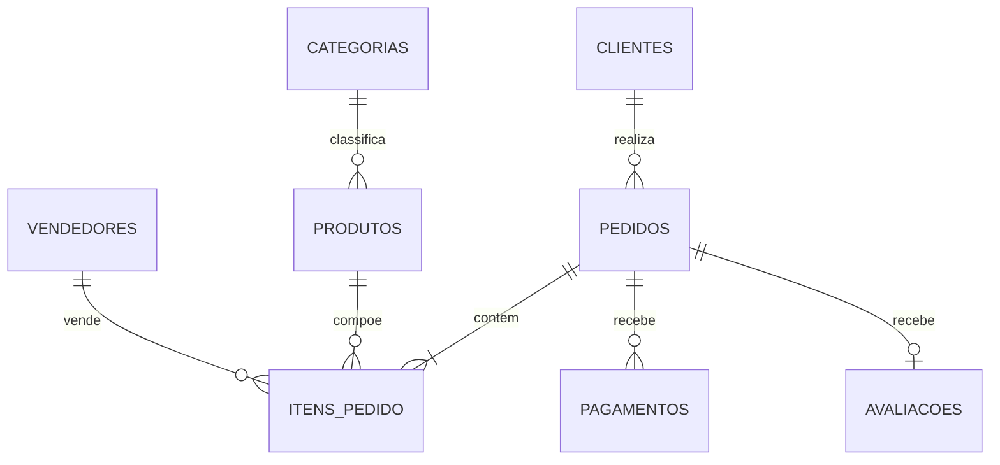

# SQL E-commerce Analytics

<p align="center">
  <strong>Um projeto de análise de dados com PostgreSQL, SQL e Python.</strong><br>
  Modelagem relacional, geração de dados sintéticos, validação de qualidade e um dashboard executivo.
</p>

<p align="center">
  
  
  
  
</p>

<p align="center">
  <a href="#visão-geral">Visão geral</a> ·
  <a href="#dashboard">Dashboard</a> ·
  <a href="#tecnologias">Tecnologias</a> ·
  <a href="#como-executar">Como executar</a> ·
  <a href="#estrutura-do-projeto">Estrutura</a>
</p>

---

## Visão geral

Este projeto explora um cenário fictício de e-commerce para praticar consultas SQL e conceitos fundamentais de engenharia e análise de dados. O fluxo inclui geração reproduzível de dados com Python, armazenamento em PostgreSQL, verificações de qualidade e disponibilização de indicadores em um painel executivo.

**Os dados são inteiramente sintéticos.** Não representam uma empresa, operação, cliente ou vendedor real. Os resultados servem para demonstrar técnicas e decisões de implementação, não para descrever um negócio real.

### O que o projeto demonstra

- Modelagem relacional com chaves primárias, estrangeiras e restrições de integridade.
- Geração determinística de dados sintéticos com Python.
- Carga de arquivos CSV em PostgreSQL.
- Consultas analíticas com CTEs, agregações, funções de janela e relacionamentos.
- Verificações de qualidade e consistência financeira.
- Exportação de resultados SQL para JSON.
- Construção de um dashboard executivo.

## Dashboard

A aplicação web está em `dashboard/` e apresenta:

- Indicadores de faturamento, pedidos, ticket médio e prazo médio.
- Evolução mensal do faturamento.
- Distribuição de pedidos por status.
- Faturamento por categoria e estado.
- Ranking de vendedores.
- Indicadores de entrega e meios de pagamento.
- Filtro de período para os KPIs e séries mensais.

Para visualizar o painel, primeiro gere o arquivo `data/dashboard.json` seguindo as instruções de execução abaixo.

## Tecnologias

| Tecnologia | Utilização |
|---|---|
| PostgreSQL 16 | Banco de dados relacional |
| SQL | Modelagem, validação e análises |
| Python 3.12 | Geração de dados e exportação |
| Faker e NumPy | Dados sintéticos |
| Psycopg | Conexão Python–PostgreSQL |
| Docker Compose | Ambiente local do banco |
| HTML, CSS e JavaScript | Dashboard e visualizações |
| GitHub Actions | Verificações automatizadas de CI |

## Modelo de dados

O banco possui oito tabelas:

| Tabela | Descrição |
|---|---|
| `clientes` | Cadastro sintético de clientes |
| `vendedores` | Cadastro sintético de vendedores |
| `categorias` | Categorias do catálogo |
| `produtos` | Produtos associados às categorias |
| `pedidos` | Pedidos realizados pelos clientes |
| `itens_pedido` | Produtos e vendedores associados a cada pedido |
| `pagamentos` | Registros de pagamento dos pedidos |
| `avaliacoes` | Avaliações associadas aos pedidos |



Mais detalhes: [documentação do modelo de dados](docs/modelo-de-dados.md).

## Como executar

### Pré-requisitos

- Git
- Python 3.12
- Docker Desktop com Docker Compose

### 1. Clonar o repositório

```bash
git clone https://github.com/annasantosabreu/sql-ecommerce-analises.git
cd sql-ecommerce-analises
python -m venv .venv
```

Ative o ambiente virtual:

**Windows PowerShell**
```powershell
.\.venv\Scripts\Activate.ps1
```

**Linux ou macOS**
```bash
source .venv/bin/activate
```

Instale as dependências:

```bash
python -m pip install -r generator/requirements.txt
```

### 2. Gerar os dados

```bash
python -m generator.gerar_dados
```

Os arquivos CSV e o manifesto da execução são gravados em `data/gerados/`.

A configuração padrão do gerador prevê:

| Entidade | Volume |
|---|---:|
| Clientes | 20.000 |
| Vendedores | 300 |
| Categorias | 50 |
| Produtos | 3.000 |
| Pedidos | 100.000 |
| Período das compras | 01/11/2024 a 31/10/2026 |

Para uma execução menor no PowerShell, por exemplo:

```powershell
$env:VOLUME_CLIENTES="200"
$env:VOLUME_VENDEDORES="10"
$env:VOLUME_CATEGORIAS="8"
$env:VOLUME_PRODUTOS="80"
$env:VOLUME_PEDIDOS="1000"
python -m generator.gerar_dados
```

A semente padrão é `20261116`. Mantendo a mesma configuração e as mesmas versões das dependências, a geração é reproduzível. Consulte `data/gerados/manifesto.json` para os totais efetivos de cada execução.

### 3. Configurar e iniciar o PostgreSQL

Crie o arquivo local de configuração:

**Windows PowerShell**
```powershell
Copy-Item .env.example .env
```

**Linux ou macOS**
```bash
cp .env.example .env
```

No arquivo `.env`, defina uma senha local em `POSTGRES_PASSWORD`. Para o exportador Python, inclua também as variáveis de conexão abaixo, usando a mesma senha:

```dotenv
PGHOST=localhost
PGPORT=5432
PGDATABASE=ecommerce
PGUSER=ecommerce
PGPASSWORD=sua_senha_local
```

Mantenha `PGPASSWORD` igual a `POSTGRES_PASSWORD`. O arquivo `.env` é local e não deve ser enviado ao Git.

Inicie o banco e confira o estado do serviço:

```bash
docker compose up -d
docker compose ps
```

Aguarde o serviço `banco` ficar saudável (`healthy`).

### 4. Criar as tabelas, carregar e validar

Execute na raiz do projeto:

```bash
docker compose exec banco psql -U ecommerce -d ecommerce -f /sql/00_schema.sql
docker compose exec banco psql -U ecommerce -d ecommerce -f /sql/01_carga.sql
docker compose exec banco psql -U ecommerce -d ecommerce -f /sql/02_qualidade.sql
```

O script de qualidade verifica, entre outros pontos, pedidos sem itens ou pagamentos, divergências financeiras, avaliações associadas a pedidos não entregues e datas fora de ordem. Entregas sem aprovação e pedidos sem avaliação são ocorrências previstas pelo gerador e devem ser interpretadas conforme a documentação.

Consulte [carga e validação](docs/validacao-carga.md) para mais detalhes.

### 5. Gerar e abrir o dashboard

Com o banco em execução e os dados carregados:

```bash
python -m dashboard.exportar
python -m http.server 8000
```

Acesse [http://localhost:8000/dashboard/](http://localhost:8000/dashboard/) no navegador. Mantenha o terminal do servidor aberto enquanto utiliza o painel.

O exportador executa as oito consultas em `sql/03_dashboard/` e grava os resultados em `data/dashboard.json`. O JSON é atualizado quando o exportador é executado.

## Consultas SQL disponíveis

### Análises gerais — `sql/03_analises/`

1. Faturamento mensal.
2. Média móvel.
3. Ticket por categoria e mês.
4. Distribuição de status.
5. Pareto por categoria.
6. Receita por estado.
7. Ranking de vendedores por categoria.
8. Entregas por estado.

### Consultas do dashboard — `sql/03_dashboard/`

Oito consultas específicas alimentam os KPIs, gráficos e tabelas do painel. As definições e limitações dos indicadores estão descritas em [docs/dashboard.md](docs/dashboard.md).

## Qualidade e validação

A integridade é protegida por chaves primárias, chaves estrangeiras, restrições `NOT NULL` e `CHECK`. O projeto também possui um script SQL dedicado a verificações pós-carga e testes automatizados para o gerador.

O estado de execução e as próximas atividades são acompanhados em [docs/plano-execucao.md](docs/plano-execucao.md). A comparação de desempenho com `EXPLAIN (ANALYZE, BUFFERS)` permanece como uma etapa futura; não são declarados ganhos de performance ainda não medidos.

## Estrutura do projeto

```text
sql-ecommerce-analises/
├── dashboard/              # Painel web e exportador PostgreSQL → JSON
├── data/                   # Dados gerados localmente (não versionados)
├── docs/                   # Documentação técnica e plano de execução
├── generator/              # Configuração e geração dos dados sintéticos
├── sql/
│   ├── 00_schema.sql       # Criação das tabelas
│   ├── 01_carga.sql        # Carga dos CSVs
│   ├── 02_qualidade.sql    # Verificações de qualidade
│   ├── 03_analises/        # Consultas analíticas
│   └── 03_dashboard/       # Consultas do painel
├── tests/                  # Testes automatizados
├── .env.example            # Modelo de configuração local
├── docker-compose.yml
└── README.md
```

## Próximas evoluções

- Completar o conjunto de análises aprofundadas (coortes, retenção, RFM, recompra e avaliações).
- Ampliar a validação independente dos resultados do dashboard.
- Implementar atualização automatizada dos dados em ambiente acessível ao GitHub Actions.
- Comparar consultas antes e depois de índices com planos de execução e métricas reais.

## Licença

Distribuído sob a licença [MIT](LICENSE).

---

<p align="center">
  Desenvolvido por <strong>Anna Luisa</strong> · <a href="https://github.com/annasantosabreu">GitHub</a>
</p>
