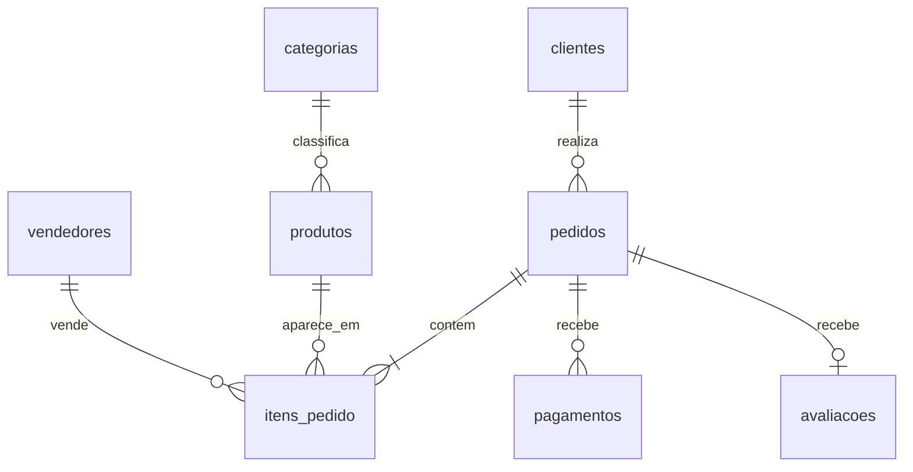

# sql-ecommerce-analises

Projeto de portfólio com análises em SQL sobre um banco PostgreSQL de e-commerce. O objetivo é praticar modelagem relacional, geração e carga reproduzível de dados, verificações de qualidade e, nas próximas etapas, análise exploratória e otimização de consultas.

> **Dados fictícios.** Todos os registros transacionais são sintéticos e gerados por um script próprio com semente fixa. Não representam uma empresa, marca, pessoa, cliente, vendedor ou operação real. Os nomes de cidades e estados são usados apenas como referências geográficas. Os resultados demonstram técnicas de dados e não permitem tirar conclusões sobre negócios reais.

## Objetivo e competências

O projeto foi planejado para demonstrar:

- Modelagem relacional com chaves primárias, estrangeiras e restrições de integridade.
- Geração determinística de dados sintéticos com Python.
- Carga de arquivos CSV no PostgreSQL.
- Verificações de integridade, consistência financeira e coerência temporal.
- Consultas analíticas com CTEs, agregações e window functions.
- Análise de coorte, retenção e segmentação RFM.
- Criação de índices e leitura de planos com `EXPLAIN (ANALYZE, BUFFERS)`.

**Status do desenvolvimento:** o modelo, o gerador e os scripts iniciais de banco, carga e qualidade estão incluídos. As consultas analíticas, a comparação de índices, a automação por Makefile e os resultados finais ainda serão adicionados e validados nas próximas etapas. Este README não apresenta métricas de negócio que ainda não tenham sido obtidas por uma execução real.

## Stack

- PostgreSQL 16
- Docker Compose
- Python 3.12
- Faker e NumPy
- SQL (`psql` e `\copy`)

## Como executar a versão atual

### Pré-requisitos

Instale Python 3.12, Docker Desktop com Docker Compose e Git. O Docker Desktop precisa estar iniciado antes de subir o banco.

### 1. Obter o projeto e preparar o ambiente Python

```bash
git clone https://github.com/annasantosabreu/sql-ecommerce-analises.git
cd sql-ecommerce-analises
python -m venv .venv
```

No Windows PowerShell, ative o ambiente e instale as dependências:

```powershell
.\.venv\Scripts\Activate.ps1
python -m pip install -r generator/requirements.txt
```

No Linux ou macOS:

```bash
source .venv/bin/activate
python -m pip install -r generator/requirements.txt
```

### 2. Gerar os dados fictícios

```bash
python -m generator.gerar_dados
```

Por padrão, os arquivos são gravados em `data/gerados/`. A geração cria oito CSVs e um `manifesto.json` com a configuração, as quantidades geradas e as ocorrências intencionais desta execução.

A configuração padrão prevê:

| Entidade | Quantidade configurada |
|---|---:|
| Clientes | 20.000 |
| Vendedores | 300 |
| Categorias | 50 |
| Produtos | 3.000 |
| Pedidos | 100.000 |
| Período das compras | 01/11/2024 a 31/10/2026 |
| Clientes recorrentes | 17,5% da base |

Esses valores descrevem a configuração padrão do gerador. Para relatar os totais de uma execução específica, consulte `data/gerados/manifesto.json`.

A semente padrão é `20261116`. Mantendo a mesma semente, configuração e versões das dependências, a geração é reproduzível. As variáveis de ambiente permitem reduzir o volume para testes locais; por exemplo, no PowerShell:

```powershell
$env:VOLUME_CLIENTES="200"
$env:VOLUME_VENDEDORES="10"
$env:VOLUME_CATEGORIAS="8"
$env:VOLUME_PRODUTOS="80"
$env:VOLUME_PEDIDOS="1000"
python -m generator.gerar_dados
```

### 3. Configurar e iniciar o PostgreSQL

No Windows PowerShell:

```powershell
Copy-Item .env.example .env
```

No Linux ou macOS:

```bash
cp .env.example .env
```

Edite `.env` e troque `POSTGRES_PASSWORD` por uma senha local. Não versione esse arquivo: ele já está listado no `.gitignore`.

Depois de gerar os CSVs e iniciar o Docker Desktop:

```bash
docker compose up -d
docker compose ps
```

Aguarde o serviço `banco` ficar saudável (`healthy`).

### 4. Criar as tabelas, carregar os CSVs e verificar a qualidade

Os comandos abaixo usam os valores padrão `ecommerce` para usuário e banco. Caso sejam alterados no `.env`, ajuste os parâmetros `-U` e `-d`.

```bash
docker compose exec banco psql -U ecommerce -d ecommerce -f /sql/00_schema.sql
docker compose exec banco psql -U ecommerce -d ecommerce -f /sql/01_carga.sql
docker compose exec banco psql -U ecommerce -d ecommerce -f /sql/02_qualidade.sql
```

A carga lê os CSVs montados em `/dados` dentro do container. O script de qualidade imprime contagens para investigar pedidos sem itens ou pagamentos, divergências entre pagamentos e itens mais frete, avaliações associadas a pedidos não entregues, entregas sem aprovação, pedidos sem avaliação e datas fora de ordem.

Para consultar a quantidade de pedidos carregados:

```bash
docker compose exec banco psql -U ecommerce -d ecommerce -c "SELECT COUNT(*) AS total_pedidos FROM pedidos;"
```

Para remover o container e o volume local do banco (isso apaga os dados armazenados no PostgreSQL):

```bash
docker compose down -v
```

## Modelo de dados

O modelo atual possui oito tabelas:



| Tabela | Granularidade | Chave primária |
|---|---|---|
| `clientes` | Um cadastro sintético por cliente | `id` |
| `vendedores` | Um cadastro sintético por vendedor | `id` |
| `categorias` | Uma categoria do catálogo | `id` |
| `produtos` | Um produto sintético | `id` |
| `pedidos` | Um pedido por transação | `id` |
| `itens_pedido` | Um produto dentro de um pedido | (`pedido_id`, `sequencia`) |
| `pagamentos` | Uma ocorrência de pagamento por pedido | (`pedido_id`, `sequencia`) |
| `avaliacoes` | No máximo uma avaliação por pedido | `id` |

A descrição das colunas, relacionamentos e decisões do modelo está em [`docs/modelo-de-dados.md`](docs/modelo-de-dados.md).

## Análises previstas

As consultas abaixo fazem parte do escopo planejado. Elas serão adicionadas em `sql/03_analises/` e executadas antes de serem apresentadas como resultados do projeto.

| # | Pergunta de análise | Técnicas previstas |
|---|---|---|
| 01 | Como evolui o faturamento mensal? | CTE, `LAG` e variação mês a mês |
| 02 | Qual a tendência do faturamento suavizada? | Média móvel e window frame |
| 03 | Qual o ticket médio por mês e categoria? | Agregação e `JOIN` |
| 04 | Em que etapa do funil os pedidos se concentram? | Agregação condicional |
| 05 | Quais categorias concentram a receita? | `SUM() OVER` e Pareto |
| 06 | Como a receita se distribui por estado? | Participação percentual |
| 07 | Quais vendedores se destacam por categoria? | `RANK`, `DENSE_RANK` e `PARTITION BY` |
| 08 | Quanto demora e atrasa a entrega por estado? | Diferença de datas e agregações |
| 09 | Como o atraso se relaciona com as avaliações? | `CASE` e agregação |
| 10 | Como os clientes retornam após a primeira compra? | Coortes mensais e retenção |
| 11 | Como segmentar clientes por RFM? | Recência, frequência, valor monetário e `NTILE` |
| 12 | Qual a taxa de recompra? | CTE e agrupamento |
| 13 | Quais meios de pagamento e parcelas aparecem com maior frequência? | Agrupamento e participação |
| 14 | Em quais dias e horários ocorrem mais pedidos? | `EXTRACT` e faixas de horário |
| 15 | Quais produtos apresentam maior proporção de avaliações baixas? | `HAVING` e amostra mínima |

## Qualidade de dados

O arquivo atual [`sql/02_qualidade.sql`](sql/02_qualidade.sql) verifica:

- Pedidos sem itens e pedidos sem pagamento.
- Conciliação do valor pago com a soma de preço e frete dos itens.
- Avaliações vinculadas a pedidos não entregues.
- Entregas sem aprovação e pedidos sem avaliação, que são ocorrências previstas pelo gerador e devem ser quantificadas.
- Datas operacionais fora de ordem.
- Distribuição dos pedidos por status.

As restrições `PRIMARY KEY`, `FOREIGN KEY`, `NOT NULL` e `CHECK` também protegem a integridade durante a carga. As contagens reais da última execução devem ser registradas depois de rodar o script no PostgreSQL; não são preenchidas antecipadamente neste README.

Mais detalhes sobre as ocorrências intencionais estão em [`docs/validacao-carga.md`](docs/validacao-carga.md) e [`docs/modelo-de-dados.md`](docs/modelo-de-dados.md).

## Resultados e otimização

Os CSVs das análises, resumos e evidências de execução serão armazenados em `resultados/` quando as consultas analíticas forem implementadas. As amostras e interpretações serão incluídas aqui somente depois de uma execução real.

A etapa de otimização comparará três consultas antes e depois de índices, usando `EXPLAIN (ANALYZE, BUFFERS)`. Os planos, tempos medidos e limitações serão documentados em `docs/otimizacao.md`. Não há tempos ou ganhos de desempenho declarados nesta versão, pois essa comparação ainda não foi executada.

## Estrutura atual do repositório

```text
sql-ecommerce-analises/
├── README.md
├── .env.example
├── .gitignore
├── docker-compose.yml
├── generator/
│   ├── Dockerfile
│   ├── config.py
│   ├── gerar_dados.py
│   └── requirements.txt
├── sql/
│   ├── 00_schema.sql
│   ├── 01_carga.sql
│   └── 02_qualidade.sql
├── tests/
│   └── test_gerador.py
└── docs/
    ├── modelo-de-dados.md
    └── validacao-carga.md
```

Os arquivos de dados gerados ficam em `data/gerados/` durante a execução, mas não devem ser enviados ao Git. O arquivo `.env` também não deve ser versionado.

## Decisões e limitações

- Os dados são sintéticos: padrões de sazonalidade, distribuição geográfica, recorrência e relação entre atraso e avaliação são regras definidas no gerador, não observações de clientes reais.
- Os pesos estaduais são aproximações usadas para diversificar a distribuição geográfica; não são estimativas estatísticas ou dados censitários.
- O gerador permite volumes menores para testes locais. A configuração padrão foi dimensionada para exercitar consultas analíticas, mas não representa uma base de produção.
- Datas operacionais são armazenadas como `TIMESTAMP` sem fuso horário e representam um calendário local sintético.
- A ausência de avaliação é esperada. Uma pequena quantidade de pedidos entregues sem data de aprovação também é intencional e documentada.
- A data final do período se refere à data da compra; eventos posteriores, como entrega e avaliação, podem ocorrer depois dela.

## O que aprendi

[Preencher com suas palavras: o que foi mais difícil, o que você faria diferente e o que aprendeu sobre SQL, modelagem e qualidade de dados.]

## Licença

A licença MIT está disponível em [`LICENSE`](LICENSE).

## Autoria

Anna Luisa · [LinkedIn](https://www.linkedin.com/in/SEU-USUARIO) · [seu-email@exemplo.com](mailto:seu-email@exemplo.com)
