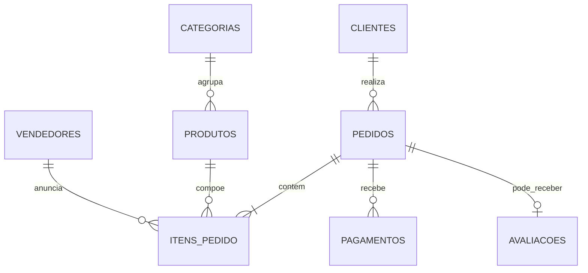

# Modelo de dados

> Todos os registros deste projeto sao sinteticos. O banco nao representa uma empresa, clientes, vendedores ou operacoes reais.

## Visao geral

O modelo representa um fluxo simplificado de comercio eletronico. As oito tabelas separam entidades de cadastro, catalogo, transacoes, itens, pagamentos e avaliacoes.

## Tabelas e granularidade

| Tabela | Granularidade | Chave primaria |
|---|---|---|
| `clientes` | Um cadastro sintetico por cliente | `id` |
| `vendedores` | Um cadastro sintetico por vendedor | `id` |
| `categorias` | Uma categoria do catalogo | `id` |
| `produtos` | Um produto sintetico | `id` |
| `pedidos` | Um pedido por transacao | `id` |
| `itens_pedido` | Um produto dentro de um pedido | (`pedido_id`, `sequencia`) |
| `pagamentos` | Uma forma/ocorrencia de pagamento por pedido | (`pedido_id`, `sequencia`) |
| `avaliacoes` | No maximo uma avaliacao por pedido | `id` |

## Relacionamentos

- Um cliente pode realizar varios pedidos; cada pedido pertence a um cliente.
- Uma categoria pode agrupar varios produtos; cada produto pertence a uma categoria.
- Um pedido possui um ou mais itens. Cada item referencia um produto e um vendedor.
- Um pedido pode possuir um ou mais registros de pagamento.
- Um pedido pode nao receber avaliacao; quando existe, a avaliacao e unica por pedido.

## Decisoes e limites do recorte

- Valores financeiros usam `NUMERIC(12,2)` para evitar aritmetica monetaria em ponto flutuante no banco.
- Datas operacionais usam `TIMESTAMP` sem fuso horario; o conjunto sintetico representa um unico calendario local de negocio.
- O endereco completo, nome e qualquer identificador pessoal nao fazem parte do modelo.
- O gerador usa localizacoes brasileiras e pesos estaduais aproximados apenas para diversificar a distribuicao geografica.
- A ausencia de avaliacao e esperada, nao uma falha de integridade.
- Uma pequena quantidade de pedidos entregues sem data de aprovacao e gerada intencionalmente para exercitar a analise de qualidade. A restricao temporal permite essa excecao documentada, mas exige que envio e entrega permaneçam em ordem.
- A data final do periodo se refere a data da compra. Eventos posteriores, como entrega e avaliacao, podem ocorrer depois dela.
